# Immediate Mode Graphical User Interface for Tools

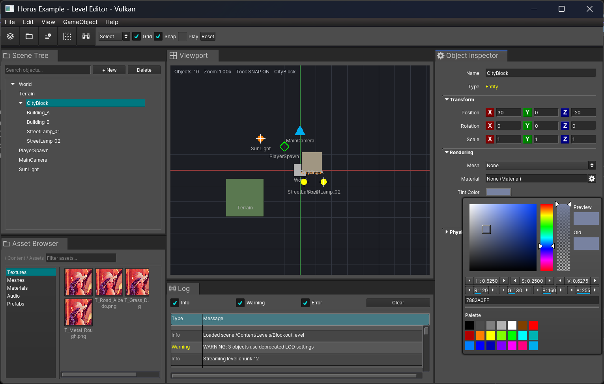

## OVERVIEW
The HorusUI library allows you to quickly develop GUIs for your applications by leveraging the ease of use provided by immediate mode GUI concepts. No need to design your GUI layout and writing many lines of boilerplate GUI preparation, imgui takes care of layouting and making sure every widget you add to the system gets drawn and responds to events.
Ideally you should be familiar with https://en.wikipedia.org/wiki/Immediate_Mode_GUI. There are other imgui libs out there, dear-imgui which is more like a debug GUI and Nuklear which resembles HorusUI.
HorusUI was specifically designed to create game editor tools or similar types of applications.

```DISCLAIMER NOTE: The library is still work in progress, changes will occur until stabilization```

For direct support: webnktu@gmail.com

If you want to help with the development, donations are welcomed:

Donations on Patreon:
<br>[](http://www.patreon.com/7thfactor)

Donations on PayPal:
<br>[](https://www.paypal.com/cgi-bin/webscr?cmd=_s-xclick&hosted_button_id=D2J3J2A766KXY)

For purists: the library was 80% done pre-AI, work done for over 5 years before.

<p align="center">
  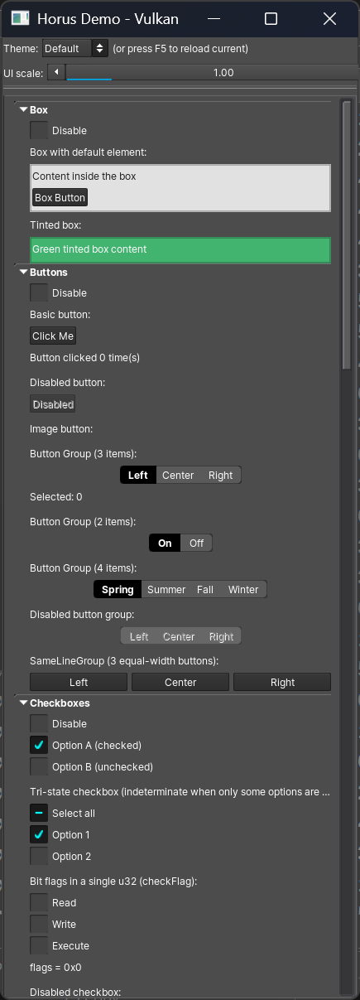
  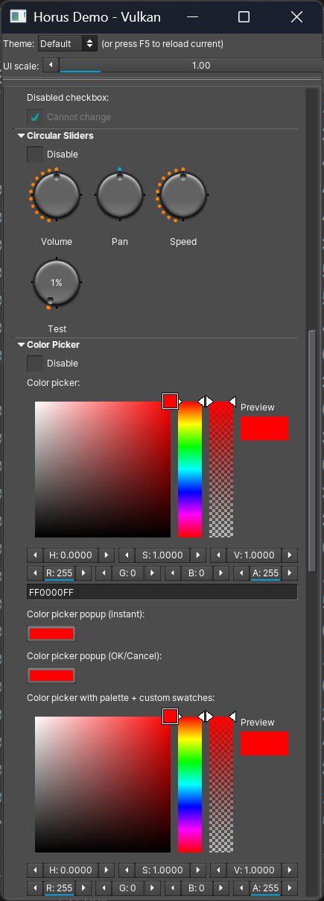
  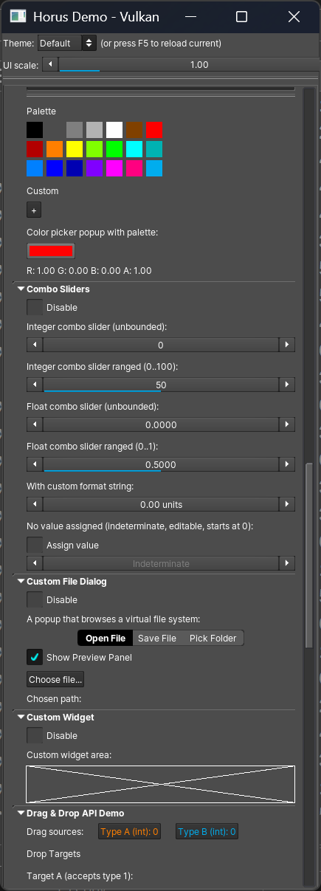
</p>

<p align="center">
  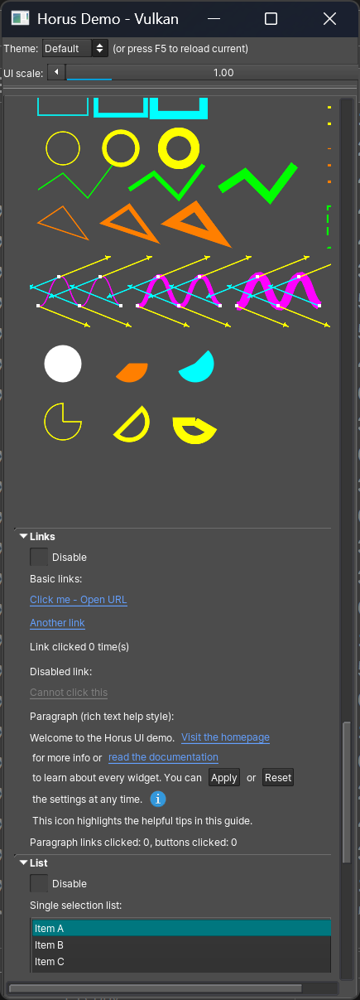
  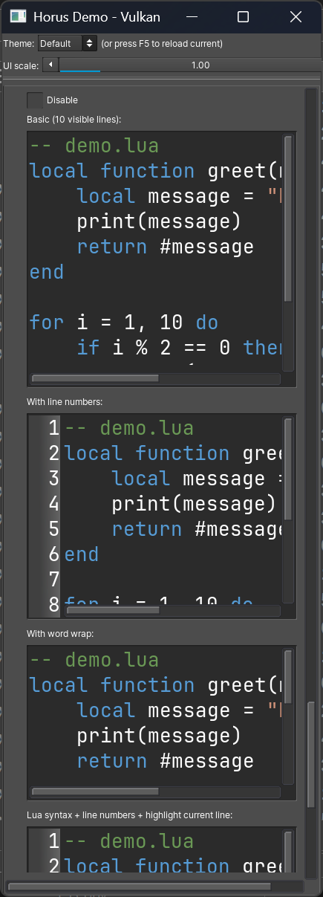
  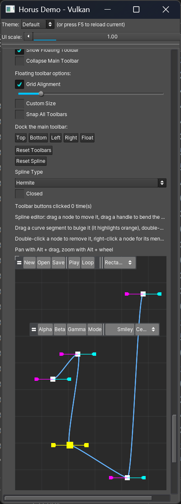
</p>

<p align="center">
  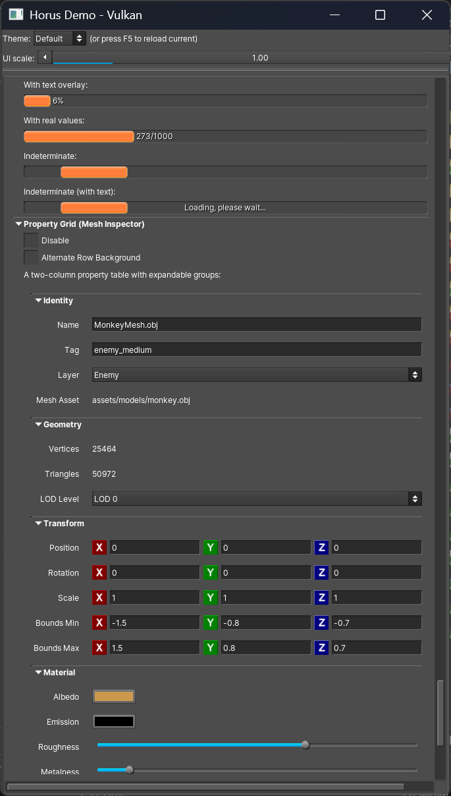
  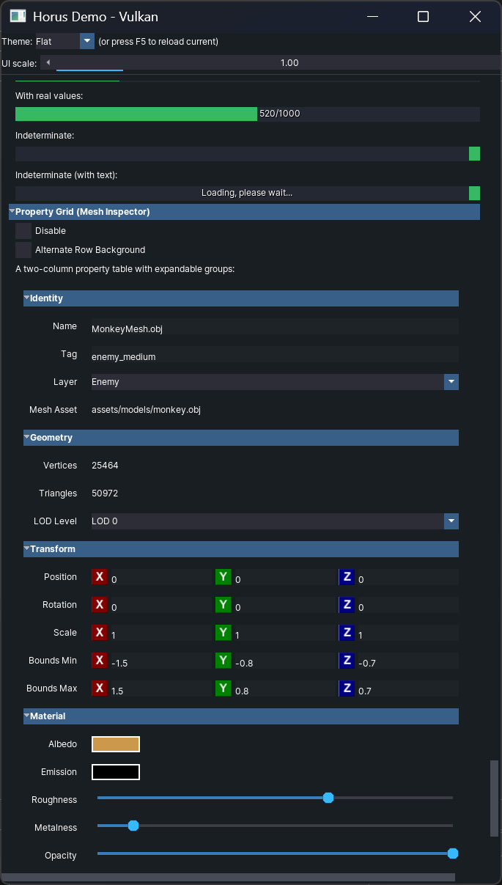
  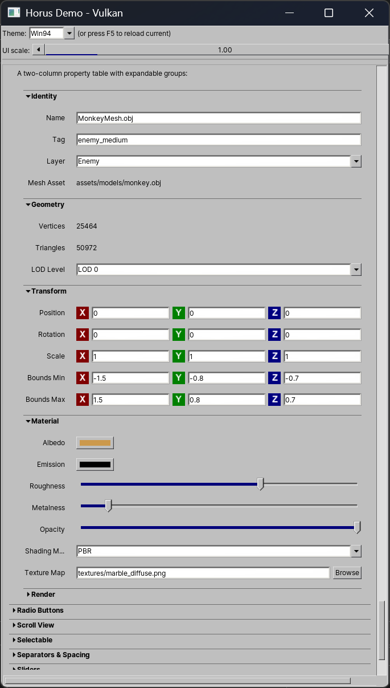
</p>

<p align="center">
  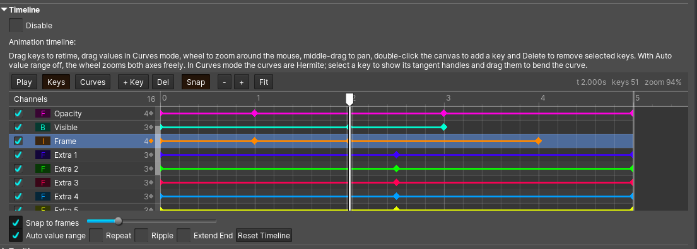
</p>

<p align="center">
  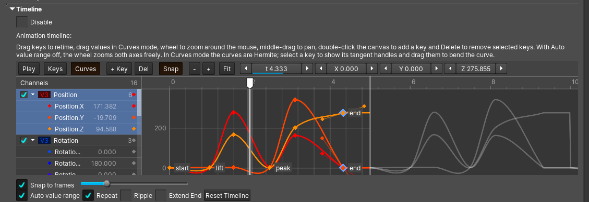
</p>

## PREREQUISITES
**Windows:**
	Microsoft Visual Studio 2022

**Linux:**
g++

GTK3 dev, needed for the nativefiledialog lib, use:
		```sudo apt-get install libgtk-3-dev```

GLU/GLUT dev, needed by GLEW, use:
		```sudo apt-get install libglu1-mesa-dev freeglut3-dev mesa-common-dev```

## BUILDING
**Windows:**
- Execute: ```generate_examples.bat```
- Open and compile: ```build/horus_examples.sln```
- Run generated files from ```./bin``` folder

**Linux:**
- Execute: ```sh ./generate_examples.sh``` to generate makefiles
- Execute: ```sh ./build_examples.sh``` to compile and generate the lib and executables for the examples
- Run generated files from the ```./bin``` folder

## FEATURES
- Immediate mode GUI, imgui (no explicit state kept per widget, user provides the state)
- Docking system with floating windows being OS native
- UTF8 text support and font glpyh rendering (baking into atlas)
- Frame throttling, it can redraw the UI only when needed, useful for non-gaming applications where continuous rendering not needed
- DPI support, scaling of the whole UI elements, useful for high DPI screens
- Fully customizable through themes specified in a JSON file with 9-cell resizable elements and PNG images
- Theme hot-reloading possible (great for theme creation)
- Widgets can have multiple full styles in the same theme (example: different button shapes/skins)
- Font atlas with multiple fonts and font sizes
- Widgets: text input (with hint text), tooltip, box, popup, messagebox, progress, button, icon button, dropdown, menu, context menu, tab, panel, radio, check, slider, toolbar etc.
- Compound Widgets: color picker, vector (max 4 components) editor, object reference editor (with dragdrop support)
- Widgets body/text color tinting override
- Virtual list view support (huge number of items)
- Automatic vertical layouting of widgets (no need to position them by hand)
- Padding (left-right) and vertical spacing for widgets
- Native Open/Save/Pick folder dialogs API
- Custom Open/Save/Pick folder dialogs (built-in)
- Generic drag and drop
- Various example backends for rendering and window/input
- Custom backends can be implemented
- Custom user widgets API
- 2D primitive drawing, lines, polylines, splines (hermite, bezier, centripetal catmull-rom, natural cubic, linear, basis), elipses, rectangles, with thickness
- Software AA (alpha skirting) for the lines
- User viewport widget (rendering your scene/document view with the current rendering API)
- Custom mouse cursor API
- Clipboard API
- Single header API
- C-like API (with simple C++ features)

## ROADMAP
- Basic Undo/Redo system
- Keyboard shortcuts system
- OSX support
- Better unicode input (show IME suggestion box)
- DPI theme elements based on current UI scale, choose the proper element bitmap size
- Customizable Object Inspector
- Customizable Node Editor

## QUICK SAMPLE (C++)
```C++
#include "horus.h"

// backends
#include "sdl3_input.h"
#include "opengl_graphics.h"
#include "json_theme_loader.h"
#include "stb_rectpack.h"
#include "freetype_fonts.h"
#include "stdio_fileio.h"
#include "utfcpp.h"

int main()
{
    // set up the service providers (backends)
    hui::Sdl3InitParams sdlParams;
    sdlParams.vSync = true;
    sdlParams.gfxApi = hui::Sdl3GfxApi::OpenGL;

    hui::Settings settings;

    hui::initStdioFileIO(settings.services);
    hui::initFreetype(settings.services);
    hui::initSdl3(settings.services, sdlParams);
    hui::initStbRectPack(settings.services);
    hui::initUtf(settings.services);
    hui::initOpenGL(settings.services);

    // create the UI context and the main window
    auto huiCtx = hui::contextCreate(settings);
    hui::contextSet(huiCtx);

    auto mainWnd = HUI_SERVICES.createWindow("Sample",
        hui::NativeWindowFlags::Resizable, hui::NativeWindowState::Normal,
        hui::Rect(0, 0, 1000, 800));

    // load + build the theme, then upload its atlas to the GPU
    char err[2048] = { 0 };
    auto theme = hui::loadThemeFromJson("../themes/default.theme.json", err, sizeof(err));

    if (!theme)
    {
        printf("Theme error: %s\n", err);
        return 1;
    }

    hui::themeSet(theme);
    hui::themeBuild(theme);

    hui::OpenGLTexture texAtlas;
    auto atlas = hui::themeGetAtlasImageData();
    texAtlas.resize(atlas.width, atlas.height);
    texAtlas.updateData(atlas.pixels);
    hui::themeSetAtlasTexture(texAtlas.getHandle());

    auto largeFnt = hui::themeFontGetFromTheme(theme, "title");

    bool exitNow = false;
    f32 sliderVal = 0;
    f32 scrollPos = 0;
    char txt[2000] = { 0 };
    bool chk1 = false, chk2 = false, chk3 = false;

    while (!exitNow)
    {
        HUI_SERVICES.setCurrentWindow(mainWnd);
        HUI_SERVICES.clearBackbuffer({ 0.3f, 0.0f, 0.2f, 1.0f });
        hui::contextGetSettings().deltaTime = hui::getSdl3DeltaTime();
        hui::contextUpdate();

        auto eventCount = hui::inputEventGetCount();

        for (i32 i = 0; i < (i32)(eventCount ? eventCount : 1); i++)
        {
            if (eventCount)
            {
                hui::inputEventSet(hui::inputEventGetAtIndex(i));

                if (hui::inputEventGet().type == hui::InputEvent::Type::WindowClose
                    && hui::inputEventGet().window == mainWnd)
                {
                    exitNow = true;
                }
            }

            bool lastEvent = eventCount == 0 || i == (i32)eventCount - 1;

            hui::nativeWindowSetCurrent(mainWnd);
            hui::renderBegin();
            hui::frameBegin();
            hui::skipRenderingThisFrame(!lastEvent);

            // user drawing code (clear scene / render 3D) would go here

            hui::layoutBegin(hui::Rect(50, 50, 350, 500));
            hui::boxBegin("panel", hui::Color::white, hui::WidgetElementId::PopupBody);
            hui::paddingPush(hui::PaddingType::Layout, hui::Point(15, 15));

            hui::labelCustomFont("Information", largeFnt);
            hui::button("Activate shields");
            hui::space();

            hui::sameLineGroupBegin(3);
            hui::check("Option 1", &chk1);
            hui::sameLineGroupNext();
            hui::check("Option 2", &chk2);
            hui::sameLineGroupNext();
            hui::check("Option 3", &chk3);
            hui::sameLineGroupEnd();

            hui::tintPush(hui::Color::cyan);
            hui::button("Browse...");
            hui::tintPop();

            hui::sliderFloat("slider1", 0, 100, sliderVal);
            hui::textInput("txt", txt, 2000, hui::TextInputFlags::None, "Write something here");
            hui::space();

            hui::scrollViewBegin("scroll1", 200, scrollPos);
            hui::labelMultiline(
                "Lorem ipsum dolor sit amet, consectetur adipiscing elit, sed do eiusmod tempor "
                "incididunt ut labore et dolore magna aliqua. Ut enim ad minim veniam, quis nostrud "
                "exercitation ullamco laboris nisi ut aliquip ex ea commodo consequat.",
                hui::HAlignType::Left);
            hui::line();
            hui::button("I AGREE");
            scrollPos = hui::scrollViewEnd().y;

            if (hui::button("Exit"))
                exitNow = true;

            hui::paddingPop(hui::PaddingType::Layout);
            hui::boxEnd();
            hui::layoutEnd();

            hui::frameEnd();
            hui::renderEnd();

            if (lastEvent)
                hui::presentNativeWindow(mainWnd);
        }
    }

    hui::contextDestroy(huiCtx);

    hui::shutdownStdioFileIO(settings.services);
    hui::shutdownFreetype(settings.services);
    hui::shutdownSdl3(settings.services);
    hui::shutdownStbRectPack(settings.services);
    hui::shutdownUtf(settings.services);
    hui::shutdownOpenGL(settings.services);
    hui::shutdown();

    return 0;
}
```

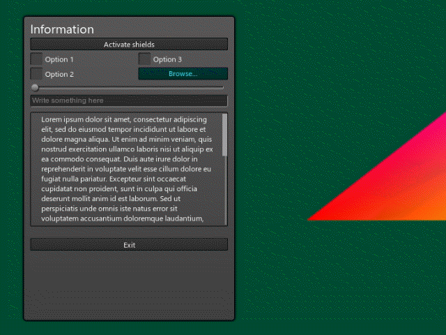
